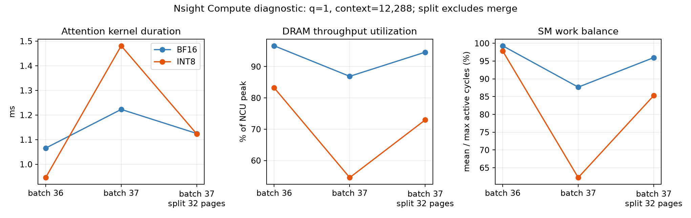

# Nsight Compute：mixed-V decode 拐点的硬件归因

2026-10-11。Windows NVIDIA App 性能计数器权限已生效，六个指定 attention kernel 均成功采集，无 ERR_NVGPUCTRPERM。结论：**V 压缩确实减少显存流量；当前 INT8 kernel 在 batch 36→37 时的明显退化，主要证据指向 CTA 工作分配的尾部拖延，而非整卡 DRAM 带宽、计算管线或寄存器溢出被打满。** 这一判断有同形状 BF16/INT8 对照、硬件计数器以及固定 KV 分片干预三方面支持。

## 测量边界与复现

- 独立诊断，不修改、不重跑正式服务。相同已通过 correctness 的 FlashInfer mixed native artifact，SHA256 `7928ba9bdc69c8e439b41f45fac5093712ea5db98e9eddc145c4456e816fedcc`。
- RTX 5060 Ti 16GB GDDR7 VRAM，36 SM；q=1，12 Q heads / 2 KV heads，head_dim=128，page=128，每请求 context=12,288。相同 shape 下各 arm 使用现有 builder 的相同 page permutation，复用原 codec/kernel。
- Nsight Compute 2026.1.1，7 sections，每次仅选一个 warmup 后的目标 kernel，19 replay passes。`--clock-control none --cache-control all`；实测 SM 约 2.70–2.72GHz，显存约 13.79GHz。未锁频且 replay 清缓存，以下 duration 是诊断 kernel 时间，不能替代正式服务吞吐或 warm eager 时间。
- 固定 split=32 pages 是独立诊断干预，每片最多4,096 KV tokens；**不是更改 xLLM 的 10,240 token 调度预算，也不是更改模型输出上限。** 分片行只 profile 主 attention kernel，未包含额外 merge kernel；此前未插 profiler 的 eager 分片实验包含整个 backend 调用。
- 原始 `.ncu-rep`、CSV、details、日志和应用记录均在本报告同目录，以 `2026-10-11-ncu-wall-` 开头。运行 argv 见 `2026-10-11-ncu-wall-manifest.json`（后续五次）；BF16 b36 使用相同参数，mode=0、batch=36。紧凑计数器见 `2026-10-11-ncu-wall-compact.json`。

## 计数器结果

显存 MB 为 `dram__bytes.sum.per_second × kernel duration` 的估计总流量，含本 kernel 的读写，不是 cache resident bytes。SM 活跃均值/最大值是跨 SM 活跃周期的比值，用于观察工作不均衡；不是 occupancy。

| Arm / batch / 分片 | Kernel ms | 显存流量 MB（估计） | 显存 GB/s | NCU DRAM throughput % | SM throughput % | SM活跃均值/最大值 | CTA数 |
|---|---:|---:|---:|---:|---:|---:|---:|
| BF16 / 36 / 默认 | 1.066 | 454.4 | 426.4 | 96.6 | 15.0 | 99.3% | 72 |
| INT8 / 36 / 默认 | 0.946 | 347.4 | 367.2 | 83.2 | 16.5 | 97.9% | 72 |
| BF16 / 37 / 默认 | 1.223 | 468.8 | 383.4 | 86.9 | 13.4 | 87.7% | 74 |
| INT8 / 37 / 默认 | 1.481 | 356.5 | 240.7 | 54.6 | 10.7 | 62.2% | 74 |
| BF16 / 37 / split32 | 1.125 | 469.6 | 417.4 | 94.6 | 14.6 | 96.0% | 222 |
| INT8 / 37 / split32 | 1.123 | 361.6 | 322.0 | 73.0 | 14.2 | 85.3% | 222 |

1. **真实流量收益存在。** 同 batch36，INT8 流量减少约23.5%，kernel 快11.2%；batch37也减少约24.0%。所以“压缩完全没有减少访问量”可以排除。
2. **拐点有明显空间尾部。** 默认每请求/每KV head一个CTA，36请求生成72 CTA，刚好等于36 SM × 每SM2CTA。37请求生成74 CTA，超过一波可同时驻留的72个槽位。INT8 的平均 SM active cycles 从约251万变为250万，最忙 SM 却从256万增到401万；最少活跃SM约237万。整卡平均工作量基本没增加，但少数SM明显拖尾。BF16同样出现尾部，最忙SM仅从289万增到331万，退化较小。
3. **不是整卡带宽/算力上限导致 INT8 b37 更慢。** INT8 b36→37 duration +56.6%，DRAM吞吐利用率从83.2%降到54.6%，SM吞吐从16.5%降到10.7%。BF16 b36 则接近显存带宽上限。低吞吐率可能正是尾部空闲的结果，不能解释成“硬件还有很多空闲，所以此轮能无代价加入更多请求”。显存能容纳请求和执行槽位能并行消化请求，是不同约束。
4. **两格式都被 shared memory 限制为2CTA/SM。** 每块约37.9KB shared memory，理论occupancy16.67%；实测约16.3–16.7%（仅 active cycles 口径，会遮蔽尾部的整卡空闲）。BF16128 registers/thread，INT8168；寄存器对应的块上限分别4和3，但 shared memory 上限均2。local/shared spilling requests均0。因此不能把本次拐点归因成“INT8寄存器多，驻留块数突然从2降到1”或“发生了spill”。
5. **未出现 INT8 每 warp 等待的突增。** INT8 b36→37 long-scoreboard cycles/issued instruction约6.06→5.93，barrier约0.34→0.39，eligible warps/scheduler约0.197→0.190；没有与56.6%延时突增相称的变化。这支持主要问题是整轮工作分配与尾部，而非全部warp突然加倍等待。上述stall是每发射指令的warp周期统计，不能当作服务时间占比；也不能直接把它解释成反量化独立耗时。
6. **分片干预能缓解。** 将INT8 b37的长CTA拆成3片，grid74→222，duration1.481→1.123ms（主kernel−24.2%），SM活跃均值/最大值62.2%→85.3%，带宽240.7→322.0GB/s。BF16也改善约8.0%。此前无profiler eager完整调用的INT8 b37约1.510→1.139ms，同方向，因此不是仅排除merge造成的假象。分片开销与更多短波次仍存在，尚未证明端到端服务能因此加速。

## 对正式服务的解释与限度

c64独立服务CUDA-event诊断中，BF16纯decode常见batch22–32，INT8常见34–41；INT8跨过这一拐点的概率更大。服务attention约23.94→41.92ms/28层，与此前同context量级的attention微基准一致。现在计数器补齐了物理证据：V压缩提高可驻留请求数，调度出的纯decode batch可能扩大；当前长上下文CTA划分越过单波边界后产生更强尾部，抵消读更少显存的收益。混合batch的大块prefill、当前反量化路径开销也仍存在，不能用一个原因覆盖全部服务时间。

已经可以判断：**当前实现的性能限制包含可优化的 kernel 工作划分；没有证据表明这些额外延迟是量化服务必然承担的固定代价。** 同样，不能因为有优化空间就改写现有正式负面结论。INT8/FP8正式高负载未获总体服务加速；INT4局部请求率收益伴随更短输出、较差质量与更高TPOT/E2E，均应保留。

本轮详细计数器只对BF16/INT8做因果对照。FP8/INT4已有同样batch拐点与相同静态驻留上限的非计数器证据，但不能声称已经分别测得它们的DRAM/warp计数器。均匀context微基准不完全等同真实异构batch；还未取得按CTA时间线或源指令位置的反量化耗时。若下一步授权优化，应在独立分支验证planner分片/工作划分，再跑同一服务trace；保留现有正式结果作为当前实现基线。

指标含义与replay限制参考[NVIDIA Nsight Compute Profiling Guide](https://docs.nvidia.com/nsight-compute/ProfilingGuide/index.html)。

