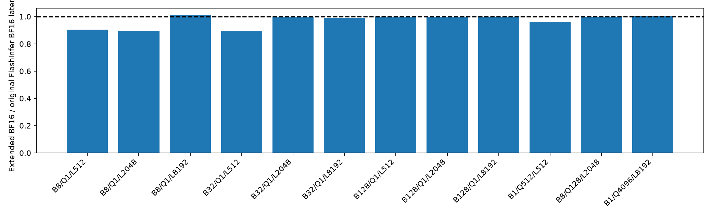
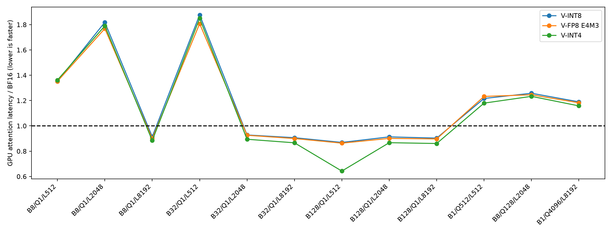

# FlashInfer mixed-V 第二版：集成与验证

第二版已接入 xLLM Python eager。BF16、V-INT8、V-FP8 E4M3、V-INT4 的 prefill、chunked prefill、mixed batch 和 decode 都使用独立的 FlashInfer FA2 Tensor Core 扩展。原版安装包和原有后端保留。

本页是实现验证和 kernel 校准，不是全量质量/饱和吞吐报告。

- 36 组 dense-reference 测试通过；实际 128-token 页、page tail、GQA6、128 序列和 32K 上下文均覆盖。
- 同样 36 组 compute-sanitizer memcheck：0 错误。
- 四个 arm 分别通过真实 Server 的 8 道 GSM8K 和 8 道 LongBench；正常 EOS 和原有 max_tokens。
- 服务测量工具 25 项检查通过，计时期间 attention 或 writer JIT 会使该轮无效。
- 仅支持当前 Qwen2.5-1.5B 的 BF16 Q、12/2 heads、head_dim128、SM120/100KiB shared memory；不支持的条件直接报错。

V 低精度 payload 和 FP32 token/head scale 常驻 VRAM。每个 tile 在 shared memory 中反量化后进入原版 BF16 MMA，没有全局 BF16 V Cache。writer、codec、allocator 和 block copy 复用原实现。

| Arm | bytes/token/layer | 相对 BF16 | 实际 KV token 容量 | resident KV GiB |
|---|---:|---:|---:|---:|
| auto | 1024 | 1.000000 | 376064 | 10.042 |
| bf16_int8 | 776 | 0.757812 | 496384 | 10.045 |
| bf16_fp8_e4m3 | 776 | 0.757812 | 496384 | 10.045 |
| bf16_int4 | 648 | 0.632812 | 594432 | 10.045 |

同一 max_memory_utilization=0.93 下，resident KV 总量接近，压缩主要扩大 token 容量。GPU 是 RTX 5060 Ti 16GB GDDR7；采样的 memory utilization 是显存控制器活跃时间，不等于峰值显存带宽利用率。

原版 BF16 校准：



四种格式使用同一 stock BF16 planner、tile geometry、QK/softmax/MMA 和 merge。12 个形状中，扩展 BF16/原版 BF16 GPU 延迟比为 0.892–1.011，处于同一量级。双方禁用 PDL；原版 BF16 输出逐元素完全一致。



短上下文、低 batch 时反量化开销可能超过节省的读取成本；大 working set 的 decode 出现约 7–36% 延迟下降。prefill 的量化版本在本组测试约慢 16–26%。这些是 kernel 结果，不能直接当作服务吞吐收益。

测量协议：page_size=128；5 次重复，随机 arm 顺序，预热后 CUDA event 测 16-node graph × 10 replay，另存 50 次 eager 调用的墙钟。Graph 只用于 kernel 诊断，服务实验仍 graph-off。CPU planner、writer、codec 不在 attention 单算子计时内。小 working set 可能命中 L2。

原始数据：[JSON](kernel_calibration_pdl_off.json)、[CSV](kernel_calibration.csv)；[正确性门槛](gates-final/correctness_gates.json)、[memcheck](gates-final/sanitizer.log)。

全量请求已在 `full-suite/` 准备：1319 GSM8K、400 LongBench，prompt/trace 哈希与原实验一致。启动：

```bash
/home/mingasa/venvs/vllm/bin/python results/flashinfer-mixed-v2-20261010/run_suite.py
```

参数固定为四 arm、并发 8/16/32/64/128、3 次重复、2 次重放、正常 EOS、相同 scheduler、0.93 显存预算。质量由这些同一批全量 timed responses 评分；报告读取实际 backend，拒绝混合不同后端。全量扫描尚未启动。
