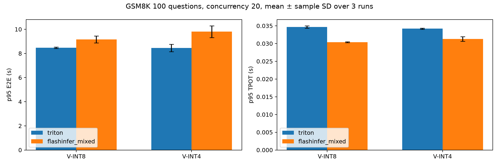
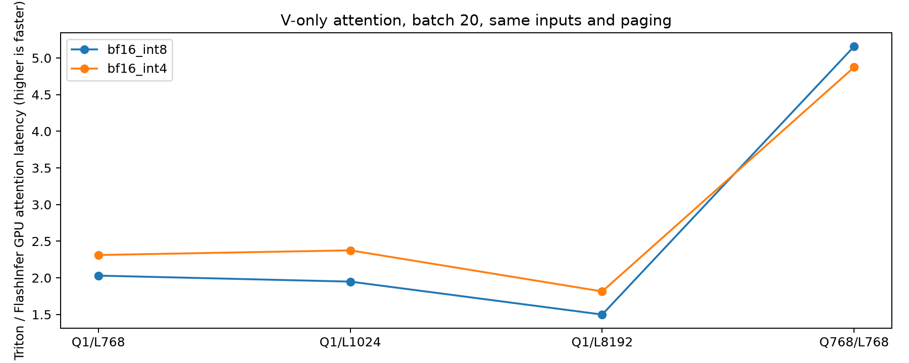

# V-only INT8/INT4：Triton 与 FlashInfer 对比

本次 C20 服务实测，相对 Triton：bf16_int8：generated tok/s 变化 +8.3%，p95 TPOT 降低 12.4%，p95 E2E 变化 +8.1%。 bf16_int4：generated tok/s 变化 +6.5%，p95 TPOT 降低 8.5%，p95 E2E 变化 +16.0%。

新 kernel 的 decode 单步更快，但本组回答平均变长，p95 整体响应时间反而上升。INT8 完成 100 请求略快，INT4 略慢；不能把单算子加速倍数直接当作服务加速倍数。

使用同一个 Qwen2.5-1.5B-Instruct checkpoint，K 保持 BF16，V 常驻 INT8 或 packed INT4，FP32 token/head scale。FlashInfer 是本次独立 FA2 扩展；两者共用现有 Triton writer/codec，没有全局 BF16 V Cache。

服务协议：现有固定 benchmark 顺序的前 100 道 GSM8K，prompt 715–819 tokens；并发 20；每组预热 20 请求后测 100 请求，重复 3 次。temperature=0、top_p=1、seed=17、正常 EOS、max_tokens=512。Python eager/graph-off，相同 scheduler（4096 tokens/batch、128 seqs/batch）、prefix cache off、max_memory_utilization=0.93。两后端串行运行，避免 GPU 资源竞争。

结果为 3 次指标的均值 ± 样本标准差；p95 是每次 100 请求 p95 的平均，不把重复的问题当独立质量样本。

| V | Backend | 总时间 s | req/s | generated tok/s | p95 TTFT ms | p95 TPOT ms | p95 E2E s |
|---|---|---:|---:|---:|---:|---:|---:|
| bf16_int8 | triton | 26.55 ± 0.37 | 3.77 ± 0.05 | 544.95 ± 3.67 | 1150.36 ± 14.97 | 34.70 ± 0.32 | 8.47 ± 0.06 |
| bf16_int8 | flashinfer_mixed | 25.74 ± 0.28 | 3.88 ± 0.04 | 590.26 ± 4.31 | 1000.75 ± 2.01 | 30.38 ± 0.11 | 9.16 ± 0.29 |
| bf16_int4 | triton | 26.02 ± 0.54 | 3.84 ± 0.08 | 533.32 ± 7.76 | 1130.60 ± 7.18 | 34.19 ± 0.15 | 8.45 ± 0.31 |
| bf16_int4 | flashinfer_mixed | 26.67 ± 1.33 | 3.76 ± 0.18 | 567.92 ± 26.69 | 1012.06 ± 8.61 | 31.30 ± 0.65 | 9.80 ± 0.49 |

| V | 平均 output tokens/request | Strict EM % | Flexible EM % | length exhaustion/100 |
|---|---:|---:|---:|---:|
| triton/bf16_int8 | 144.67 ± 2.44 | 44.33 ± 0.58 | 63.33 ± 0.58 | 0.00 ± 0.00 |
| flashinfer_mixed/bf16_int8 | 151.95 ± 0.52 | 46.00 ± 1.00 | 65.67 ± 1.15 | 0.00 ± 0.00 |
| triton/bf16_int4 | 138.74 ± 1.42 | 44.67 ± 0.58 | 64.67 ± 2.31 | 0.00 ± 0.00 |
| flashinfer_mixed/bf16_int4 | 151.22 ± 0.33 | 40.00 ± 3.00 | 62.67 ± 0.58 | 0.00 ± 0.00 |

输出长度不强制相同。质量分数只描述这 100 题，用来检查输出行为；不能作为全量 GSM8K 或量化相对 BF16 的质量结论。
两个 backend 的 attention 数值路径不同：FlashInfer 在 shared memory 反量化为 BF16 后做 Tensor Core MMA；Triton 保留其原有运算路径。因此即使低精度 payload 相同，输出也不保证逐位一致。本次单算子逐项对照通过 atol=0.015、rtol=0.02，正常 EOS 服务结果仍需要如实保留长度和答案差异。

| V | Q tokens/request | Context tokens | Triton GPU us | FlashInfer GPU us | GPU speedup | 共享 writer GPU us |
|---|---:|---:|---:|---:|---:|---:|
| bf16_int8 | 1 | 768 | 77.12 | 37.98 | 2.03× | 1.93 |
| bf16_int4 | 1 | 768 | 84.47 | 36.54 | 2.31× | 1.71 |
| bf16_int8 | 1 | 1024 | 95.02 | 48.77 | 1.95× | 1.67 |
| bf16_int4 | 1 | 1024 | 111.48 | 46.93 | 2.38× | 1.65 |
| bf16_int8 | 1 | 8192 | 693.54 | 462.66 | 1.50× | 1.86 |
| bf16_int4 | 1 | 8192 | 816.21 | 449.79 | 1.81× | 3.69 |
| bf16_int8 | 768 | 768 | 5671.19 | 1099.42 | 5.16× | 53.77 |
| bf16_int4 | 768 | 768 | 5243.19 | 1075.72 | 4.87× | 67.46 |

单算子均 B20、page128，相同 Q/K/V 和 shuffled pages，5 次重复、随机 backend/arm 顺序。CUDA event 测预热后的 graph batch 16×10；另存 50 次 eager 墙钟。Graph 只是 kernel 诊断；服务仍 graph-off。attention-only 包括其 split/merge，不计 planner 和 writer。writer 单独测量，两个后端用的是同一个实现。Q768×20 的完整 prefill 是独立 kernel 形状；服务实际会受 4096-token batch budget 限制而分批。

原始文件：[服务 CSV](service.csv)、[服务汇总 JSON](service_summary.json)、[单算子 CSV](kernels.csv)、[单算子 JSON](kernels.json)、[协议与 trace 哈希](protocol.json)。各 backend 子目录保存 startup 参数、环境/源码哈希、实际 resident allocation、100 条逐请求响应和低开销 GPU/server 采样。

所有 12 次服务 replay 都必须完成 100 请求、并发峰值 20、prompt/token 计数匹配，且没有 attention/writer JIT，才生成本页。TTFT 是客户端首个非空文本的时间；TPOT=(E2E−TTFT)/(API generated tokens−1)。延迟从 HTTP 提交起，包含 server 等待，排除客户端 semaphore 排队。memory utilization 是 GDDR7 显存控制器活跃时间，不等于峰值显存带宽利用率。只测 C20，不据此宣称饱和吞吐或容量上限。
